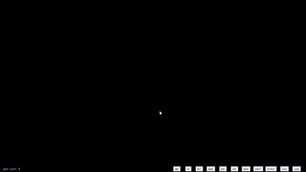

# Digital Circuit Simulator (EDA Engine & Interactive GUI)

[](https://en.cppreference.com/w/cpp/17)
[]()
[](LICENSE)

An interactive digital logic design tool and Electronic Design Automation (EDA) simulation engine written in C++17. The project features a headless, mathematically rigorous DAG-based logic evaluation engine with three-valued logic (`LOW`, `HIGH`, `UNDEFINED`), topological levelization, cycle/feedback detection, and an interactive desktop graphical interface powered by SFML.



---

## Table of Contents
- [Overview & Motivation](#overview--motivation)
- [Architecture & Simulation Engine](#architecture--simulation-engine)
- [Verified Features & Gate Types](#verified-features--gate-types)
- [Repository Structure](#repository-structure)
- [Technology Stack & Prerequisites](#technology-stack--prerequisites)
- [Build and Launch Instructions](#build-and-launch-instructions)
  - [Building with CMake (Recommended)](#building-with-cmake-recommended)
  - [Building with Makefile](#building-with-makefile)
- [Automated Testing & Verification](#automated-testing--verification)
- [Design Decisions & Engineering Challenges](#design-decisions--engineering-challenges)
- [Independent Contributions](#independent-contributions)
- [Known Limitations & Future Roadmap](#known-limitations--future-roadmap)
- [Attribution & License](#attribution--license)

---

## Overview & Motivation

In hardware description languages (Verilog, VHDL) and digital logic synthesis, circuit simulation relies on deterministic signal propagation through directed acyclic graphs (DAGs). Traditional toy simulators often evaluate gates sequentially in arbitrary array order inside a rendering loop, which causes artificial frame delays (16.6 ms per logic level) and erratic oscillation on feedback loops.

This project modernizes the simulator into a professional **two-tier EDA architecture**:
1. **Core Simulation Engine (`engine/`):** A headless, zero-dependency C++17 library managing netlists, pins, multi-input gates, three-valued IEEE logic, topological levelization (Kahn's algorithm), driver contention validation, and cycle detection.
2. **Interactive GUI Frontend (`source_files/`, `main.cpp`):** A modern desktop UI using SFML supporting interactive component placement, wire tracing, signal inspection, and persistence.

---

## Architecture & Simulation Engine

```
+-------------------------------------------------------------------------+
|                          Graphical Frontend (SFML)                      |
|   Canvas Interaction | Component Drag-and-Drop | Wire Path Rendering     |
+------------------------------------+------------------------------------+
                                     |
                                     v
+-------------------------------------------------------------------------+
|                       Core Simulation Engine (C++17)                    |
|                                                                         |
|  +--------------------+   +-------------------+   +------------------+  |
|  |     Netlist /      |   |  Topological DAG  |   |   Three-Valued   |  |
|  |   Circuit Graph    |-->|      Sorter       |-->|   Logic (0/1/X)  |  |
|  |  (Gates & Wires)   |   |  (Kahn's/DFS)     |   |    Evaluation    |  |
|  +--------------------+   +-------------------+   +------------------+  |
|            |                                                |           |
|            v                                                v           |
|  +--------------------+                           +------------------+  |
|  | Netlist Serializer |                           | Cycle & Feedback |  |
|  |   (Save / Load)    |                           |  Loop Detector   |  |
|  +--------------------+                           +------------------+  |
+-------------------------------------------------------------------------+
```

### Simulation Workflow
1. **Circuit Modeling:** Gates, primary inputs, and output probes are modeled with strong pin directionality (`INPUT` sink vs. `OUTPUT` driver).
2. **Connection Validation:**
   - **Driver Contention Rejection:** Prevents multiple output drivers from wiring into a single input pin (preventing electrical short-circuits).
   - **Self-Loop Rejection:** Blocks connecting a gate's output pin directly to its own input pin.
   - **Duplicate Connection Check:** Rejects duplicate wires across the same pin pairs.
3. **Graph Levelization & Cycle Detection:**
   - The engine builds a directed dependency graph.
   - Uses **Kahn's Algorithm** and **Depth-First Search (DFS)** to detect cycles and compute the exact topological evaluation order.
4. **Deterministic Evaluation:**
   - For acyclic circuits (DAG), signals propagate level-by-level in topological order in **0 extra frames**, settling instantly.
   - For cyclic circuits, an iterative relaxation loop settles valid latches or identifies oscillation with explicit status reporting (`CircuitStatus::HAS_CYCLE`).
5. **Three-Valued Logic Handling:** Floating or un-driven pins evaluate strictly to `LogicValue::UNDEFINED` (`X`), following dominant CMOS logic rules (e.g., $0 \text{ AND } X = 0$, $1 \text{ OR } X = 1$).

---

## Verified Features & Gate Types

| Component / Gate | Symbol / Type | Functionality & Truth Table Highlights |
|:---|:---|:---|
| **AND Gate** | `GateType::AND` | $Y = A \cdot B$ (Dominant 0; $0 \cdot X = 0$) |
| **OR Gate** | `GateType::OR` | $Y = A + B$ (Dominant 1; $1 + X = 1$) |
| **NOT Gate** | `GateType::NOT` | $Y = \overline{A}$ ($\overline{0}=1, \overline{1}=0, \overline{X}=X$) |
| **NAND Gate** | `GateType::NAND` | $Y = \overline{A \cdot B}$ (Universal gate) |
| **NOR Gate** | `GateType::NOR` | $Y = \overline{A + B}$ (Universal gate) |
| **XOR Gate** | `GateType::XOR` | $Y = A \oplus B$ (Parity / addition sum bit) |
| **XNOR Gate** | `GateType::XNOR` | $Y = \overline{A \oplus B}$ (Equivalence checker) |
| **Input Signal** | `InputSource` | User-toggled logic driver (Primary Input) |
| **Output Probe** | `OutputProbe` | Circuit logic state probe (Primary Output) |

### Interactive GUI Shortcuts
* **Place Element:** Click toolbar buttons at bottom (`AND`, `OR`, `NOT`, `INPUT`, `OUTPUT`, `SAVE`, `LOAD`).
* **Move Component:** Left-click and drag on component.
* **Toggle Input State:** `Alt + Left Click` on an Input Signal.
* **Create Connection:** Click and drag from an output pin to an input pin.
* **Delete Component:** Right-click on component.
* **Delete Connection:** `Ctrl + Right Click` on component.
* **Clear All Connections:** `Ctrl + C`
* **Clear All Elements:** `Ctrl + X`
* **Duplicate Component:** `Shift + Left Click`
* **Exit Program:** `Esc`

---

## Repository Structure

```
digital-circuit-simulator-main/
├── CMakeLists.txt              # Modern CMake build system (engine, tests, GUI)
├── Makefile                    # Multi-target Makefile (test, simulator, clean)
├── LICENSE                     # MIT License with upstream attribution
├── readme.md                   # Technical documentation and architecture guide
├── main.cpp                    # GUI entry point and event loop
├── engine/                     # Core EDA Simulation Engine (Zero GUI Dependencies)
│   ├── Circuit.hpp / .cpp      # Graph model, topological sort, cycle detection
│   ├── GateType.hpp / .cpp     # Gate enumerations and string reflection
│   ├── LogicGate.hpp / .cpp    # Multi-input gate evaluation logic
│   ├── LogicValue.hpp / .cpp   # 3-valued logic (LOW, HIGH, UNDEFINED)
│   ├── Pin.hpp                 # Input/output pin directionality and state
│   ├── Serializer.hpp / .cpp   # Netlist serialization and deserialization
│   └── Wire.hpp                # Net connection model
├── tests/                      # Automated Test Suite (Pure C++17)
│   ├── test_framework.hpp      # Lightweight test runner with assertion macros
│   ├── test_gates.cpp          # Unit tests for all gate truth tables
│   ├── test_circuits.cpp       # Integration tests (Half/Full Adders, DAG, validation)
│   └── test_main.cpp           # Test suite entry point
├── header_files/               # GUI headers
│   ├── sfml_compat.hpp         # Cross-version SFML 2.x and SFML 3.x compatibility
│   ├── button.hpp              # UI button widgets
│   ├── components.hpp          # UI toolbar and component management
│   ├── connection.hpp          # Graphical wire renderer
│   ├── fontManager.hpp         # Asset loader
│   ├── gate.hpp                # Graphical gate representation
│   ├── inputSignal.hpp         # Interactive input driver widget
│   ├── outputSignal.hpp        # Interactive output monitor widget
│   ├── port.hpp                # Graphical pin interface
│   └── statusBar.hpp           # Canvas status bar
├── source_files/               # GUI implementations
│   ├── button.cpp
│   ├── components.cpp
│   ├── connection.cpp
│   ├── fontManager.cpp
│   ├── gate.cpp
│   ├── inputSignal.cpp
│   ├── outputSignal.cpp
│   ├── port.cpp
│   └── statusBar.cpp
└── assets/                     # Fonts, icons, and demonstration media
    ├── demo.gif
    ├── fonts/Hack-Regular.ttf
    └── images/logic.png
```

---

## Technology Stack & Prerequisites

* **C++ Compiler:** Modern C++17 compliant compiler (`g++` $\ge 9.0$, `clang++` $\ge 10.0$, or MSVC $\ge 2019$).
* **Build Systems:** `CMake` $\ge 3.16$ or `GNU Make` / `mingw32-make`.
* **Libraries:**
  * **Core Engine & Tests:** 100% Standard C++ (Zero external dependencies).
  * **GUI Frontend:** SFML 2.5+ or SFML 3.x (`sfml-graphics`, `sfml-window`, `sfml-system`).

### Installing Prerequisites
* **Windows (MSYS2 UCRT64 / MinGW):**
  ```bash
  pacman -S mingw-w64-ucrt-x86_64-gcc mingw-w64-ucrt-x86_64-cmake mingw-w64-ucrt-x86_64-make mingw-w64-ucrt-x86_64-sfml
  ```
* **Ubuntu / Debian:**
  ```bash
  sudo apt-get update && sudo apt-get install build-essential cmake libsfml-dev
  ```
* **macOS (Homebrew):**
  ```bash
  brew install cmake sfml
  ```

---

## Build and Launch Instructions

### Building with CMake (Recommended)

1. **Configure Build:**
   ```bash
   cmake -B build -G "MinGW Makefiles"
   ```
   *(On Linux/macOS, simply omit `-G "MinGW Makefiles"`)*

2. **Build and Run Test Suite:**
   ```bash
   cmake --build build --target circuit_tests
   ./build/circuit_tests.exe    # Windows
   ./build/circuit_tests        # Linux/macOS
   ```

3. **Build and Launch GUI Simulator:**
   ```bash
   cmake --build build --target circuit_simulator
   ./build/circuit_simulator.exe   # Windows
   ./build/circuit_simulator       # Linux/macOS
   ```

### Building with Makefile

1. **Run Automated Tests:**
   ```bash
   make test
   # Or on Windows MinGW:
   mingw32-make test
   ```

2. **Build GUI Simulator:**
   ```bash
   make simulator
   # Or on Windows MinGW:
   mingw32-make simulator
   ```

3. **Launch Simulator:**
   ```bash
   make run
   # Or on Windows MinGW:
   mingw32-make run
   ```

4. **Clean Build Artifacts:**
   ```bash
   make clean
   # Or on Windows MinGW:
   mingw32-make clean
   ```

---

## Automated Testing & Verification

The project includes an automated unit and integration test suite executed without GUI dependencies.

### Actual Test Results (Verified)
```text
========================================================
  DIGITAL CIRCUIT SIMULATOR - AUTOMATED TEST SUITE
========================================================

--- [ GateTruthTables ] ---
  [PASS] TestNOTGate
  [PASS] TestANDGate
  [PASS] TestORGate
  [PASS] TestNANDGate
  [PASS] TestNORGate
  [PASS] TestXORGate
  [PASS] TestXNORGate

--- [ CircuitEngine ] ---
  [PASS] TestHalfAdderCircuit
  [PASS] TestFullAdderMultiLevelDAG

--- [ Validation ] ---
  [PASS] TestDriverContentionAndSelfLoops
  [PASS] TestDisconnectedInputsDetection
  [PASS] TestCycleAndFeedbackDetection

--- [ Persistence ] ---
  [PASS] TestSaveLoadRoundTrip

========================================================
  TEST EXECUTION SUMMARY
========================================================
  Total Tests: 13
  Passed:      13
  Failed:      0
  Time:        1.54 ms
========================================================
  RESULT: ALL TESTS PASSED!
```

---

## Design Decisions & Engineering Challenges

1. **Elimination of Undefined Behavior (`delete this` in Destructors):**
   * *Problem:* The legacy codebase invoked `delete this;` inside destructors of `Gate`, `Connection`, `InputSignal`, and `OutputSignal`. Calling `delete` resulted in infinite recursive destructor calls and immediate crashes. To avoid crashes, the original implementation simply erased pointers from vectors without deleting them, leaking 100% of heap allocations.
   * *Solution:* Removed all `delete this;` calls. Refactored vector cleanup and removal routines to deallocate heap memory cleanly using proper RAII principles.

2. **Elimination of Unbounded Vector Leak in Logic Evaluation:**
   * *Problem:* In legacy `Gate::logicOperation()`, early-return branches (NOT gate and partially connected gates) failed to call `bools.clear()`. At 60 frames per second, the vector pushed dozens of booleans every second, continuously leaking memory and corrupting gate states.
   * *Solution:* Replaced ad-hoc vector accumulation with deterministic evaluation using pure logic functions and mandatory vector clearing at start and exit.

3. **Decoupling Core EDA Engine from SFML GUI:**
   * *Problem:* Logic evaluation, truth tables, and state management were tightly coupled with SFML graphics shapes and window events. Running tests required graphical window initialization.
   * *Solution:* Extracted a standalone, pure C++17 `engine/` library. The simulation engine now runs headlessly on any platform or CI environment.

4. **Topological Levelization & Instant Propagation (DAG):**
   * *Problem:* Gates previously evaluated in arbitrary array order inside the render loop, introducing an artificial 16.6 ms delay per logic level.
   * *Solution:* Implemented Kahn's algorithm for topological sorting. Multi-level circuits (such as a 3-level Full Adder) evaluate in exact dependency order and settle in a single evaluation cycle with zero lag.

5. **Cross-Version SFML Compatibility (SFML 2.x and SFML 3.x):**
   * *Problem:* Modern package managers (e.g. MSYS2 UCRT64) ship SFML 3.0+, which introduces breaking API changes (`sf::Rect::size`, `pollEvent()` returning `std::optional`, `sf::Angle`, scoped enums, `openFromFile`).
   * *Solution:* Developed `header_files/sfml_compat.hpp` with clean compile-time adapters, enabling seamless compilation on both legacy SFML 2.x and modern SFML 3.x systems.

6. **Robust Netlist Persistence:**
   * *Problem:* Legacy `save()` and `load()` commented out wire connections and ignored inputs/outputs. Exact float equality (`==`) caused coordinate lookup failures.
   * *Solution:* Engineered a structured serialization schema (`# DIGITAL CIRCUIT SIMULATOR NETLIST V2`) recording gates, inputs, outputs, coordinates, and exact wire pin connections with fuzzy-radius coordinate matching on load.

---

## Independent Contributions

* **Engine Architecture:** Designed and implemented the standalone `eda::Circuit`, `eda::LogicGate`, `eda::LogicValue`, `eda::Pin`, and `eda::Wire` modules in `engine/`.
* **Graph Algorithms:** Implemented Kahn's topological sort and DFS cycle detection algorithms for deterministic logic evaluation.
* **Multi-Valued Logic:** Formulated IEEE 1164-style 3-valued logic (`LOW`, `HIGH`, `UNDEFINED`) with dominant-state CMOS propagation.
* **Automated Testing Suite:** Built a comprehensive 13-test test suite (`tests/`) covering truth tables, multi-level adders, driver contention, cycle detection, and serialization round-trips.
* **Bug Fixes:**
  * Fixed recursive `delete this;` destructor crash bugs across all 4 component classes.
  * Resolved unbounded `bools` vector accumulation leak in gate evaluation.
  * Corrected connection serialization and restoration.
  * Eliminated compiler warnings under `-Wall -Wextra`.
* **Build Systems:** Created a cross-platform `CMakeLists.txt` with CTest support and a modernized multi-platform `Makefile`.
* **Compatibility Layer:** Created `header_files/sfml_compat.hpp` for SFML 2 and SFML 3 interoperability.

---

## Known Limitations & Future Roadmap

* **Clocked Sequential Logic:** The engine currently models combinational logic and basic level-sensitive loops. Future work will introduce edge-triggered Flip-Flops (D-FF, JK-FF) and clock generation.
* **Hierarchical Subcircuits:** Ability to package a multi-gate circuit (e.g., Full Adder, ALU) into a reusable custom black-box component with custom symbol pins.
* **Timing & Gate Delays:** Inertial and transport propagation delay modeling ($t_{pd}$, $t_{cd}$) for glitch and hazard simulation.
* **Waveform Viewer (VCD Export):** Exporting simulation state transitions into standard Value Change Dump (`.vcd`) files for analysis in GTKWave.

---

## Attribution & License

* **Original Author:** [Binit Awasthi](https://github.com/binit-awasthi) — [digital-circuit-simulator](https://github.com/binit-awasthi/digital-circuit-simulator).
* **Modernization & EDA Engine:** [Tanya Verma](https://github.com/tanyaverma20) — [Digital-Circuit-Simulator](https://github.com/tanyaverma20/Digital-Circuit-Simulator).
* **Graphic Assets:** Logic gate icons created by [orvipixel - Flaticon](https://www.flaticon.com/free-icons/logic). Font: Hack font (SIL Open Font License).
* **License:** Released under the [MIT License](LICENSE).
